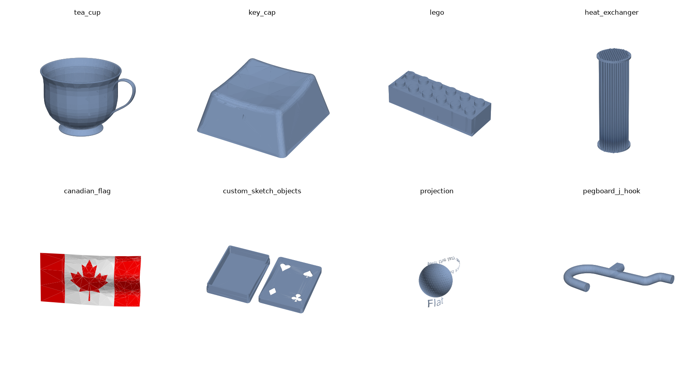

# build123d-cpp

A C++ port of [build123d](https://github.com/gumyr/build123d), the Python CAD library, built
directly on [OpenCASCADE](https://dev.opencascade.org/) (OCCT). It covers everything in
build123d 0.13 except builder mode (`BuildPart`, `BuildSketch`, `BuildLine`): the algebra API,
the topology classes, every object and operation, joints and assemblies, drafting, and all
importers and exporters. Results are checked against Python build123d itself.

```cpp
#include <build123d/build123d.hpp>
using namespace build123d;

int main() {
    Part plate = Box(80, 60, 10) - GridLocations(60, 40, 2, 2) * Cylinder(3, 10);
    plate = fillet(plate.edges().filter_by(Axis::Z), 5);
    plate -= Pos(0, 0, 5) * CounterBoreHole(4, 7, 3, 10);
    export_step(plate, "plate.step");
}
```

The same model in Python build123d:

```python
plate = Box(80, 60, 10) - GridLocations(60, 40, 2, 2) * Cylinder(3, 10)
plate = fillet(plate.edges().filter_by(Axis.Z), 5)
plate -= Pos(0, 0, 5) * CounterBoreHole(4, 7, 3, 10)
export_step(plate, "plate.step")
```



*Some of the ported examples, as written by the C++ programs in `examples/`
(rendered with `scripts/render_examples.py`).*

## What it covers

- **Geometry**: `Vector`, `Axis`, `Location`/`Pos`/`Rot`, `Plane`, `BoundBox`,
  `OrientedBoundBox`, `Matrix`, `Color`, length and mass units, and `GeomEncoder` (JSON).
  Intersections between them return what Python returns (a point, an axis, a plane, …).
- **Topology**: `Vertex`, `Edge`, `Wire`, `Face`, `Shell`, `Solid`, `Compound` and the algebra
  types `Curve`, `Sketch`, `Part`, with all of build123d's methods. That includes:
  - intersection and `touch` in every dimension and with geometry;
  - history, so `part.edges(Select::NEW)` gives the edges the last operation created;
  - convexity, mass/material/inertia, hashing, Gordon surfaces, wrapping faces onto surfaces;
  - the topology helpers `topo_explore_connected_edges`, `topo_explore_common_vertex`,
    `topo_distance_to`, `new_edges`, `delta`, `polar` and `edges_to_wires`.
- **Assemblies**: `children`, with `parent()`, `root()`, `path()`, `descendants()`, `leaves()`,
  `global_location()`, … (build123d's anytree tree).
- **Joints**: `RigidJoint`, `RevoluteJoint`, `LinearJoint`, `CylindricalJoint`, `BallJoint`,
  `connect_to`, `relative_to`, and their symbols.
- **Algebra**: `+`, `-`, `&` (and `+=`, `-=`, `&=`) with build123d's semantics, also with lists;
  placement with `Location * shape`, `Plane * shape` and `locations * shape`; `%` (tangent) and
  `^` (location) on curves.
- **Selectors**: `ShapeList` (set semantics like Python's), with `sort_by`, `group_by`,
  `filter_by`, `filter_by_position`, the `> < >> << |` operators and Python-style slicing.
- **Objects**:
  - 1D: `Line`, `Polyline`, `Spline`, `Bezier`, `BSpline`, `BlendCurve`, `CenterArc`,
    `ThreePointArc`, `RadiusArc`, `SagittaArc`, `TangentArc`, `JernArc`, `DoubleTangentArc`,
    `EllipticalCenterArc`, `EllipticalStartArc`, `ParabolicCenterArc`, `HyperbolicCenterArc`,
    `Helix`, `PolarLine`, `FilletPolyline`, `IntersectingLine`, `ConstrainedArcs`,
    `ConstrainedLines`, `Airfoil`. Arcs and `PolarLine` can end at a shape, axis, plane or point.
  - 2D: `Circle`, `Ellipse`, `Rectangle`, `RectangleRounded`, `Polygon`, `RegularPolygon`,
    `Trapezoid`, `Triangle`, `SlotArc`, `SlotCenterPoint`, `SlotCenterToCenter`, `SlotOverall`,
    `Superellipse`, `Text` (any font, including the bundled single-line font, with
    `FontManager` and `available_fonts`).
  - 3D: `Box`, `Cylinder`, `Cone`, `Sphere`, `Torus`, `Wedge`, `Hole`, `CounterBoreHole`,
    `CounterSinkHole`, `ConvexPolyhedron`.
  - Drafting: `Draft`, `DimensionLine`, `ExtensionLine`, `Arrow`, `ArrowHead`,
    `TechnicalDrawing`.
  - Custom objects derive from `BaseCurveObject`, `BaseLineObject`, `BaseEdgeObject`,
    `BaseSketchObject` or `BasePartObject`, as in Python.
- **Locations**: `Locations`, `GridLocations`, `PolarLocations`, `HexLocations`.
- **Operations**: `extrude`, `revolve`, `loft`, `sweep`, `section`, `thicken`, `draft`, `fillet`,
  `chamfer`, `full_round`, `offset`, `mirror`, `scale`, `split`, `project`, `project_workplane`,
  `make_face`, `make_hull`, `make_brake_formed`, `trace`, `bounding_box`, `pack`.
- **Import and export**:
  - `export_step` (assemblies with names and colors), `export_brep`, `export_stl`,
    `export_gltf` (glTF and GLB) and `export_obj`; 3MF and STL meshes with `Mesher`;
  - 2D drawings with `ExportSVG` and `ExportDXF`, from hidden-line views (`project_to_viewport`);
  - `import_svg`, `import_svg_as_buildline_code`, `import_dxf`, `import_step`, `import_brep`,
    `import_stl`, and `detect_primitives` (faces from a mesh);
  - `serialize_shape`/`deserialize_shape`, which write and read the same bytes as Python's
    `persistence` module, and `to_bytes`/`from_bytes`, which save a shape with its label, color
    and children (Python's pickling);
  - `export_to_pcbway` (3D printing quotes);
  - `shape_to_html` and VTK output for viewers (Jupyter's display of a shape).

## How it was checked

Everything above was checked against Python build123d 0.13.0 itself, not just compiled:

- `tests/compare` builds the same 855 models and values in C++ and in Python and compares them:
  shapes by volume, area, total edge length, topology counts, bounding box and center of mass
  (to 1e-6 relative); other results value by value (points, axes, mass properties, file
  contents, …). All of them match.
- All 24 of build123d's official algebra examples are ported in `examples/`. The 47 objects they
  show match their Python originals the same way.
- `tests/test_*.cpp` has 58 unit tests for the C++ API itself (static result types, joints and
  tree semantics, error handling, file round trips, PCBWay uploads against a local server).

Results with different OCCT versions (Python build123d itself runs on OCCT 8.0.1):

| OCCT | unit tests | comparison cases | example objects |
|---|---|---|---|
| 8.0.0 | all | all | all |

The comparisons with older OCCT versions differ only where OCCT itself behaves differently:
the version written into STEP and glTF headers, slightly different meshes, and a few
geometric operations.

## Building

Requirements:
- CMake ≥ 3.16.
- A C++17 compiler. The examples and tests need C++20, because they use designated
  initializers.
- OCCT 7.6 or newer with its CMake config files.
- lib3mf (for `Mesher`).
- libcurl (optional, for `export_to_pcbway`; without it that function throws).

Builds were tested on Linux x86-64 with GCC.

```sh
cmake -S . -B build -G Ninja -DCMAKE_PREFIX_PATH=/path/to/occt
cmake --build build
./build/examples/tea_cup        # prints its properties and writes tea_cup.step
./build/build123d_tests
```

If you don't have the dependencies, `scripts/setup-toolchain.sh` creates a self-contained
toolchain (OCCT 8.0 without VTK, lib3mf, libcurl, CMake, Ninja and GCC from conda-forge) in
`./.toolchain` without root access, and prints the commands to build with it:

```sh
scripts/setup-toolchain.sh
.toolchain-bin/micromamba run -p ./.toolchain cmake -S . -B build -G Ninja -DCMAKE_PREFIX_PATH=$PWD/.toolchain
.toolchain-bin/micromamba run -p ./.toolchain cmake --build build
```

To use the library from another CMake project, either `add_subdirectory()` this directory or
install it (`cmake --install build --prefix …`) and use `find_package`:

```cmake
find_package(build123d CONFIG REQUIRED)
target_link_libraries(my_app PRIVATE build123d::build123d)
```

The bundled single-line font is installed to `<prefix>/share/build123d/fonts`. The library looks
for it in `$BUILD123D_FONT_DIR`, next to the program or library, in the install prefix and in the
source tree.

Programs that use VTK can `#include <build123d/vtk.hpp>` for `to_vtk_poly_data`, which returns a
`vtkPolyData`; link VTK yourself. The rest of the library doesn't depend on VTK.

### Comparing with Python build123d

With a Python environment that has `build123d==0.13.0` (and `vtk`, for the viewer cases):

```sh
python tests/compare/compare.py build/compare_cases           # the models and values
python tests/compare/compare_examples.py build/examples       # the examples
```

## From Python to C++

| Python | C++ |
|---|---|
| `from build123d import *` | `#include <build123d/build123d.hpp>` and `using namespace build123d;` |
| `Box(1, 2, 3, align=Align.MIN)` | `Box(1, 2, 3, Align::MIN)` |
| `Box(1, 2, 3, align=(Align.MIN, Align.CENTER, Align.MAX))` | `Box(1, 2, 3, {Align::MIN, Align::CENTER, Align::MAX})` |
| `extrude(s, 5, both=True, taper=10)` | `extrude(s, 5, {.both = true, .taper = 10})` |
| `extrude(s, until=Until.NEXT, target=part)` | `extrude(s, Until::NEXT, part)` |
| `offset(part, -1, openings=faces)` | `offset(part, -1, {.openings = faces})` |
| `sweep(sections, path, multisection=True)` | `sweep(sections, path, {.multisection = true})` |
| `Text("hi", 10, font_style=FontStyle.BOLD)` | `Text("hi", 10, {.font_style = FontStyle::BOLD})` |
| `Triangle(a=3, b=4, c=5)` | `Triangle({.a = 3, .b = 4, .c = 5})` |
| `CenterArc((0, 0), 1, 0, arc_size=line)` (a limit) | `CenterArc({0, 0}, 1, 0, line)` |
| `curve @ 0.5` | `curve.position_at(0.5)` |
| `curve % 0.5`, `curve ^ 0.5` | `curve % 0.5`, `curve ^ 0.5` |
| `part.volume`, `edge.length`, `vertex.X` | `part.volume()`, `edge.length()`, `vertex.X()` |
| `faces()[-1]`, `faces()[1:3]`, `faces().last` | `faces()[-1]`, `faces().slice(1, 3)`, `faces().last()` |
| `edges().filter_by(lambda e: e.length > 1)` | `edges().filter_by([](const Edge& e) { return e.length() > 1; })` |
| `edges().group_by(Edge.radius)` | `edges().group_by([](const Edge& e) { return e.radius(); })` |
| `edges() > Axis.Z`, `>>`, `<<`, `\|` | the same operators |
| `part.edges(Select.NEW)` | `part.edges(Select::NEW)` |
| `GridLocations(5, 5, 2, 2) * Circle(1)` | `GridLocations(5, 5, 2, 2) * Circle(1)` |
| `Plane(origin=(0, 0, 5), z_dir=(1, 0, 0))` | `Plane({0, 0, 5}, std::nullopt, {1, 0, 0})` |
| `Plane(origin, x_dir=x, y_dir=y)` | `Plane::from_x_y(origin, x, y)` |
| `Rot(Z=45)` | `Rot(0, 0, 45)` |
| `Pos(*point)` | `Pos(point)` |
| `axis.intersect(plane)` (a Vector, an Axis or None) | `axis.intersect(plane)`: `std::optional<std::variant<Vector, Axis>>` |
| `part.intersect(other)` (a ShapeList or None) | `part.intersect(other)`: a `ShapeList<Shape>`, empty for None |
| `top, bottom = part.split(plane, keep=Keep.BOTH)` | `auto [top, bottom] = part.split(plane, Keep::BOTH);` |
| `Compound(children=[a, b])` | `Compound::make_assembly({a, b})`, or `Compound c; c.children = {a, b};` |
| `child.parent = assembly` | `assembly.children.push_back(child)` (the tree stores a copy) |
| `node.global_location` | `node.global_location()` |
| `RigidJoint("j", part, location)` | the same |
| `a.joints["j"].connect_to(b.joints["k"], angle=90)` | `a.joints["j"].connect_to(b.joints["k"], {.angle = 90})` |
| `with SkipClean(): ...` | `{ SkipClean skip; ... }` |
| `show(part)` (a viewer) | `export_step(part, "part.step")`, or `shape_to_html(part)` |
| `ValueError`, `TypeError` | `std::invalid_argument` |
| `IndexError`, `KeyError` | `std::out_of_range` |
| `ZeroDivisionError` | `std::domain_error` |
| `RuntimeError`, OCCT failures | `std::runtime_error` |
| `warnings.warn(...)` | `build123d::warn(...)`; redirect or silence with `set_warning_handler` |

Option structs use C++20 designated initializers, which must follow the order the fields
are declared in (see `operations.hpp` and `objects.hpp`). Untyped results (`import_step`,
`import_brep`, the elements of `intersect`, …) are `Shape`s; get a specific type with
`cast_shape<Solid>(shape)` or `std::visit(…, cast_shape(shape))` (Python's `Shape.cast`).

### Static types

The algebra keeps track of dimensions at compile time:

- `Box + Sphere` is a `Part`, `Circle - Rectangle` is a `Sketch` and `Line + Arc` is a
  `Curve`. Python returns a `Wire` or an `Edge` when curves join; in C++ it's always a `Curve`.
- `a & b` is a `Part` for two 3D shapes, a `Sketch` for 3D & 2D and a `Curve` for 3D & 1D.
  Every other combination is a `Compound`, because those results can mix dimensions (two
  crossing lines meet in a vertex). A `Compound` converts to `Sketch`, `Curve` or `Part`,
  checked when it runs.
- Adding shapes of different dimensions (`Box(1, 1, 1) + Circle(1)`) does not compile.
- Placement keeps the type: `Pos(1, 0) * Box(…)` is a `Part`, and `Rot(…) * edge` is an
  `Edge`.
- `Part`, `Sketch` and `Curve` don't convert into each other.
- `fillet`/`chamfer` of vertices return a `Compound`, which converts to `Sketch` or `Curve`.

Python code that changes a variable's type needs a different declaration in C++:

```cpp
Curve s = Spline({{30, 10}, {69, 105}}, {{1, 0.5}, {0.7, 1}});  // not `Spline s`
s += Polyline({...});                                          // Spline + Polyline is a Curve
Part cup = revolve(Plane::XZ * make_face(s), Axis::Z);          // a new variable, not `s =`
```

Inside a class derived from a shape type, the shape's own member functions (`mirror`,
`scale`, `fillet`, …) hide the free operations of the same name. Call them as
`build123d::mirror(…)`, or build the shape in a free function (see
`examples/custom_sketch_objects.cpp`).

### Values, joints and assemblies

Shapes are values: copying one copies it, where Python shares the object.

- An assembly owns its children: `children.push_back(shape)` stores a copy, and every child
  knows its parent (`parent()`) through copies and moves. As in Python, changing the children of
  a compound rebuilds its geometry from them.
- Joint objects are handles to the joint in their part's `joints`: `j.connect_to(...)` and
  `part.joints["j"].connect_to(...)` act on the same joint. Copying a part gives the copy its
  own joints (Python's deepcopy does the same). A joint whose part was destroyed throws.

### Differences from Python build123d

Where Python build123d has a bug, the C++ is the corrected version:

- `Edge::param_at_point` returns the parameter along the edge's orientation, so
  `position_at(param_at_point(p)) == p` also for reversed edges.
- `Wire::location_at` with `FrameMethod::CORRECTED` in parameter mode normalizes the position
  once (Python does it twice).
- `IntersectingLine` ignores intersections behind its start point.
- `Location(plane, offset)` applies the offset (Python ignores it).
- `Color(0)` is black (Python makes it white).

Smaller differences:

- Assigning `Shape::material` doesn't recolor the shape; Python's setter applies the
  material's color.
- `Face::wrap_faces` leaves the faces it is given unchanged (Python moves them).
- Where Python returns something in an arbitrary order (from a `set`), the C++ keeps the order
  found: `ShapeList` set operations, `Face::axes_of_symmetry`, `FontManager::register_folder`.
- Numbers that Python formats differently as int and float (e.g. a drawing scale of `2`) are
  formatted as floats.
- `shape_to_html`, `to_vtkpoly_string` and `vtk_mesh` don't need VTK. The VTK text has the same
  content as Python's but isn't compressed.
- `to_bytes` uses its own format, so it can't read Python pickles (the shape data inside them,
  `serialize_shape`'s bytes, is the same). Unlike Python, it can save a shape that has a color.
- `export_to_pcbway` only opens http(s) pages, and never through a shell.
- Before OCCT 8, OCCT's exceptions don't derive from `std::exception`: an OCCT error that the
  library doesn't translate arrives as a `Standard_Failure`.

### Not ported

Builder mode: `BuildPart`, `BuildSketch`, `BuildLine`, `Mode`, the builder-context selector
functions, `add`/`insert`, locations used as context managers and the `mode=` arguments.

## Layout

```
include/build123d/   public headers (build123d.hpp includes them all; vtk.hpp needs VTK)
src/                 implementation
data/fonts/          the bundled single-line font (SIL Open Font License)
examples/            ports of build123d's algebra examples; show.hpp prints results
tests/test_*.cpp     unit tests
tests/compare/       comparison with Python build123d
scripts/             toolchain setup; render_examples.py draws docs/examples.png
cmake/               the package config for find_package(build123d)
```

## License

This is a port of build123d, which is licensed under the Apache License 2.0; the files in
`examples/` are ports of build123d's examples, and `src/template_render.inc` is build123d's
`template_render.js`. Keep build123d's license and notices when distributing this code. The
bundled Relief SingleLine CAD font is under the SIL Open Font License
(`data/fonts/reliefsingleline/OFL.txt`).
